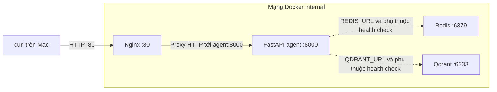

# Day 14 Lab · Mission Answers

## Part 1 · Localhost vs Production

### Exercise 1.1 · Các vấn đề trong bản develop

| Vấn đề | Dòng code | Ảnh hưởng khi triển khai |
|---|---|---|
| Thông tin nhạy cảm được ghi trực tiếp vào mã nguồn | [develop/app.py:17](01-localhost-vs-production/develop/app.py#L17) | API key và thông tin kết nối mẫu nằm trong source. Nếu dùng thông tin thật, người có quyền xem repo, image hoặc lịch sử Git có thể lấy được chúng. |
| Cấu hình nằm rải trong code | [develop/app.py:20](01-localhost-vs-production/develop/app.py#L20) | Các giá trị như `DEBUG` và `MAX_TOKENS` được gán trực tiếp. Việc đổi cấu hình theo môi trường đòi hỏi sửa code. |
| Log in API key và nội dung câu hỏi | [develop/app.py:32](01-localhost-vs-production/develop/app.py#L32) | `print()` đưa key và nội dung người dùng vào log. Log được lưu hoặc chuyển tới hệ thống tập trung có thể làm lộ dữ liệu. |
| Thiếu endpoint kiểm tra sức khỏe | [develop/app.py:42](01-localhost-vs-production/develop/app.py#L42) | Hệ thống triển khai thiếu endpoint riêng để kiểm tra tiến trình còn sống và ứng dụng đã sẵn sàng nhận request. |
| Host và cổng cố định | [develop/app.py:49](01-localhost-vs-production/develop/app.py#L49) | App chỉ bind vào `localhost` và cố định cổng `8000`. Cổng này đã xung đột trên máy lab, nên lần test dùng Uvicorn với cổng khác. |
| Tự động reload khi chạy bằng `python app.py` | [develop/app.py:53](01-localhost-vs-production/develop/app.py#L53) | Tiến trình theo dõi file và có thể khởi động lại khi file thay đổi. Tính năng này phục vụ chỉnh sửa code tại chỗ. |
| Thiếu bước dọn tài nguyên ở tầng ứng dụng khi tắt | [develop/app.py:13](01-localhost-vs-production/develop/app.py#L13) | Bản develop dùng vòng đời mặc định. Khi ứng dụng có tài nguyên riêng như kết nối DB, cần một chỗ để dọn chúng lúc shutdown. |

### Exercise 1.2 · Kết quả gọi bản develop

Chạy trong `01-localhost-vs-production/develop`. Lần kiểm tra dùng cổng `8011` vì bản production của CP1 đang chạy ở `8010`.

```zsh
python -m uvicorn app:app --host 127.0.0.1 --port 8011
```

Từ tab test, gửi câu hỏi qua tham số query.

```zsh
curl -i -X POST 'http://127.0.0.1:8011/ask?question=Hello'
```

Phản hồi thực tế:

```text
HTTP/1.1 200 OK
content-type: application/json

{"answer":"Đây là câu trả lời từ AI agent (mock). Trong production, đây sẽ là response từ OpenAI/Anthropic."}
```

### Exercise 1.3 · So sánh với bản production

| Hạng mục | Develop | Production | Vì sao quan trọng |
|---|---|---|---|
| Config và secret | Chuỗi key mẫu và thiết lập nằm trong code. | `Settings` đọc `OPENAI_API_KEY`, `AGENT_API_KEY` và các thiết lập từ biến môi trường. [config.py:26](01-localhost-vs-production/production/config.py#L26) | Dùng cùng mã nguồn cho nhiều môi trường và có thể thay key mà không phải sửa source. |
| Host, cổng và reload | `localhost:8000` và `reload=True` được ghi cố định. | Uvicorn dùng `settings.host`, `settings.port` và `settings.debug`. [app.py:194](01-localhost-vs-production/production/app.py#L194) | Có thể chọn cổng trống trên máy lab hoặc dùng cổng do nền tảng cấp. Chế độ debug mặc định tắt. |
| Health và readiness | Chỉ có `/` và `/ask`. | `/health` báo tiến trình còn hoạt động. `/ready` dùng cờ `is_ready` và trả `503` khi app chưa sẵn sàng. [app.py:135](01-localhost-vs-production/production/app.py#L135) · [app.py:152](01-localhost-vs-production/production/app.py#L152) | Hệ thống triển khai có thể kiểm tra tiến trình còn sống và quyết định khi nào nên gửi traffic. |
| Logging | `print()` in câu hỏi, key và câu trả lời. | Log request và response ghi các trường như `event`, `question_length` và `response_length`. Các đoạn log này bỏ giá trị API key. [app.py:110](01-localhost-vs-production/production/app.py#L110) | Trường cố định giúp lọc log theo sự kiện và giảm dữ liệu nhạy cảm trong log. |
| Graceful shutdown | Dùng vòng đời mặc định của app. | Có `lifespan` với bước shutdown mẫu, đặt `is_ready = False` và ghi log khi tắt. [app.py:39](01-localhost-vs-production/production/app.py#L39) · [app.py:63](01-localhost-vs-production/production/app.py#L63) | Giai đoạn shutdown riêng tạo chỗ để kết thúc việc đang làm và đóng tài nguyên theo thứ tự. Bản mẫu mô phỏng bước dọn tài nguyên. |

**Đối chiếu một thay đổi cụ thể.** [develop/app.py:52](01-localhost-vs-production/develop/app.py#L52) truyền `port=8000` trực tiếp cho Uvicorn. Bản production lấy `PORT` qua [config.py:18](01-localhost-vs-production/production/config.py#L18) và truyền `port=settings.port` ở [app.py:197](01-localhost-vs-production/production/app.py#L197). Nhờ vậy, lệnh `HOST=127.0.0.1 PORT=8010 python app.py` chạy được trên cổng `8010` mà không cần sửa file.

**Kiểm tra bản production trên cổng 8010.**

```zsh
curl -i 'http://127.0.0.1:8010/health'
curl -i -X POST 'http://127.0.0.1:8010/ask' \
  -H 'Content-Type: application/json' -d '{"question":"Hello"}'
```

- `GET /health` trả `HTTP/1.1 200 OK`, với `status` là `ok`.
- `POST /ask` trả `HTTP/1.1 200 OK`, với `question` là `Hello`, `answer` là câu trả lời mock và `model` là `gpt-4o-mini`.

## Part 2 · Docker

### Exercise 2.1 · Dockerfile cơ bản

1. **Base image.** `FROM python:3.11` dùng image Python 3.11 đầy đủ làm nền cho container. [Dockerfile develop, dòng 8](02-docker/develop/Dockerfile#L8)
2. **Working directory.** `WORKDIR /app` đặt `/app` làm thư mục làm việc cho các chỉ thị tiếp theo. Ví dụ, `COPY ... .` ghi vào `/app` và `CMD` khởi động tại đó. [Dockerfile develop, dòng 11](02-docker/develop/Dockerfile#L11)
3. **Thứ tự `COPY`.** Dockerfile copy `requirements.txt` rồi chạy `pip install` trước khi copy source. Khi chỉ sửa `app.py`, Docker có thể dùng lại cache của lớp cài dependencies. Thay đổi `requirements.txt` sẽ khiến lớp đó được build lại. [Dockerfile develop, dòng 14](02-docker/develop/Dockerfile#L14)
4. **`CMD` và `ENTRYPOINT`.** `CMD` cung cấp lệnh mặc định hoặc các đối số mặc định cho `ENTRYPOINT`. Với dạng exec, nếu cấu hình cả hai thì Docker ghép `ENTRYPOINT` với các đối số từ `CMD`. Đối số sau tên image trong `docker run` thay thế `CMD`. Để thay `ENTRYPOINT` khi chạy, dùng `--entrypoint`. Image develop dùng `CMD ["python", "app.py"]` để đặt lệnh chạy mặc định. [Dockerfile develop, dòng 30](02-docker/develop/Dockerfile#L30)

### Exercise 2.2 · Build và chạy container develop

Chạy lệnh build từ gốc repo. Container dùng cổng nội bộ `8000` và mở cổng `8010` trên máy.

```zsh
docker build -f 02-docker/develop/Dockerfile -t my-agent:develop .
docker run -d --rm --name k5-day14-cp2-dev-retry \
  -p 127.0.0.1:8010:8000 my-agent:develop
```

Sau khi app khởi động, gọi `POST /ask` với câu hỏi trong query string.

```zsh
curl -i -X POST 'http://127.0.0.1:8010/ask?question=What%20is%20Docker%3F'
```

Phản hồi thực tế:

```text
HTTP/1.1 200 OK
server: uvicorn
content-type: application/json

{"answer":"Container là cách đóng gói app để chạy ở mọi nơi. Build once, run anywhere!"}
```

### Exercise 2.3 · Multi-stage build và kích thước image

- **Stage `builder`.** Dùng `python:3.11-slim`, cài `gcc` và `libpq-dev`, rồi dùng `pip install --user` để cài dependencies vào `/root/.local`. [Dockerfile production, dòng 16](02-docker/production/Dockerfile#L16)
- **Stage `runtime`.** Bắt đầu từ một lớp nền `python:3.11-slim` mới, copy dependencies và mã ứng dụng, rồi chạy Uvicorn dưới user `appuser`. Nền slim và việc để công cụ build lại ở stage trước làm image cuối nhỏ hơn. [Dockerfile production, dòng 36](02-docker/production/Dockerfile#L36)

```zsh
docker build -f 02-docker/production/Dockerfile -t my-agent:advanced .
docker image ls my-agent
```

Kích thước được Docker hiển thị trong lần đo:

| Image | Cột `SIZE` | Đổi sang MB để tính |
|---|---:|---:|
| `my-agent:develop` | 1.67 GB | 1.670 MB |
| `my-agent:advanced` | 240 MB | 240 MB |

Dùng cùng đơn vị thập phân, tỷ lệ giảm xấp xỉ **85,6%**, tính bằng `(1670 − 240) / 1670 × 100`. Đây là giá trị xấp xỉ vì cột `SIZE` được làm tròn.

### Exercise 2.4 · Docker Compose và kiểm tra Nginx



Cả bốn service cùng dùng mạng Docker `internal` và tìm nhau bằng tên service. Compose chờ Redis và Qdrant báo healthy trước khi khởi động agent. Nginx nhận request từ máy qua cổng `80` và chuyển tới `agent:8000`. Redis được cấu hình cho cache/state và Qdrant cho lưu vector. Endpoint mock `/ask` trong bài gọi hàm `ask(question)` trực tiếp. [Docker Compose](02-docker/production/docker-compose.yml#L22) · [Nginx upstream](02-docker/production/nginx/nginx.conf#L14) · [Endpoint /ask](02-docker/production/main.py#L57)

Chạy các lệnh sau trong `02-docker/production`.

```zsh
touch .env.local
docker compose -p k5-day14-docker up -d --build --wait --wait-timeout 100
docker compose -p k5-day14-docker ps
curl -i 'http://127.0.0.1/health'
curl -i -X POST 'http://127.0.0.1/ask' \
  -H 'Content-Type: application/json' -d '{"question":"Explain microservices"}'
```

Kết quả thực tế ghi nhận một container cho mỗi service. Agent, Redis và Qdrant đều báo `healthy`, còn Nginx báo `Up`.

| Request qua Nginx | Kết quả thực tế |
|---|---|
| `GET /health` | `HTTP/1.1 200 OK`, header `Server: nginx`, JSON có `"status":"ok"` và `"version":"2.0.0"`. |
| `POST /ask` | `HTTP/1.1 200 OK`, header `Server: nginx`, JSON `{"answer":"Tôi là AI agent được deploy lên cloud. Câu hỏi của bạn đã được nhận."}`. |

Sau khi ghi kết quả, container develop đã được dừng và stack production đã được dọn bằng `docker compose -p k5-day14-docker down`.

## AI log

- **CP1, ngày 26-11-2026.** Câu hỏi gửi AI là cách xử lý xung đột cổng và cách hoàn thiện Exercise 1.1–1.3. AI đối chiếu mã nguồn, chạy các lệnh kiểm tra local và soạn phần Part 1 từ phản hồi thực tế. Người học đã tạo môi trường Python và khởi động bản production trên cổng `8010`. 
- **CP2, ngày 26-11-2026.** 1–2.4. AI đọc Dockerfile và Compose, chạy lại hai lệnh build trên máy lab, đo kích thước bằng Docker, thử container develop và stack Nginx, rồi ghi kết quả vào Part 2. 
