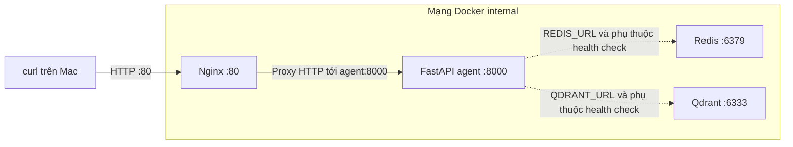

# Day 14 Lab · Mission Answers

## Part 1 · Localhost vs Production

### Exercise 1.1 · Các vấn đề trong bản develop

| Vấn đề | Dòng code | Ảnh hưởng khi triển khai |
|---|---|---|
| Thông tin nhạy cảm được ghi trực tiếp vào mã nguồn | [develop/app.py:17](01-localhost-vs-production/develop/app.py#L17) | API key và thông tin kết nối mẫu nằm trong source. Nếu dùng thông tin thật, người có quyền xem repo, image hoặc lịch sử Git có thể lấy được chúng. |
| Cấu hình nằm rải trong code | [develop/app.py:20](01-localhost-vs-production/develop/app.py#L20) | Các giá trị như `DEBUG` và `MAX_TOKENS` được gán trực tiếp. Việc đổi cấu hình theo môi trường đòi hỏi sửa code. |
| Log in API key và nội dung câu hỏi | [develop/app.py:32](01-localhost-vs-production/develop/app.py#L32) | `print()` đưa key và nội dung người dùng vào log. Log được lưu hoặc chuyển tới hệ thống tập trung có thể làm lộ dữ liệu. |
| Thiếu endpoint kiểm tra sức khỏe | [develop/app.py:42](01-localhost-vs-production/develop/app.py#L42) | Hệ thống triển khai thiếu endpoint riêng để kiểm tra tiến trình còn sống và ứng dụng đã sẵn sàng nhận request. |
| Host và cổng cố định | [develop/app.py:49](01-localhost-vs-production/develop/app.py#L49) | App chỉ bind vào `localhost` và cố định cổng `8000`. Cổng này đã xung đột trên máy lab, nên lần test dùng Uvicorn với cổng khác. |
| Tự động reload khi chạy bằng `python app.py` | [develop/app.py:53](01-localhost-vs-production/develop/app.py#L53) | Tiến trình theo dõi file và có thể khởi động lại khi file thay đổi. Tính năng này phục vụ chỉnh sửa code tại chỗ. |
| Thiếu bước dọn tài nguyên ở tầng ứng dụng khi tắt | [develop/app.py:13](01-localhost-vs-production/develop/app.py#L13) | Bản develop dùng vòng đời mặc định. Khi ứng dụng có tài nguyên riêng như kết nối DB, cần một chỗ để dọn chúng lúc shutdown. |

### Exercise 1.2 · Kết quả gọi bản develop

Chạy trong `01-localhost-vs-production/develop`. Lần kiểm tra dùng cổng `8011` vì bản production của CP1 đang chạy ở `8010`.

```zsh
python -m uvicorn app:app --host 127.0.0.1 --port 8011
```

Từ tab test, gửi câu hỏi qua tham số query.

```zsh
curl -i -X POST 'http://127.0.0.1:8011/ask?question=Hello'
```

Phản hồi thực tế:

```text
HTTP/1.1 200 OK
content-type: application/json

{"answer":"Đây là câu trả lời từ AI agent (mock). Trong production, đây sẽ là response từ OpenAI/Anthropic."}
```

### Exercise 1.3 · So sánh với bản production

| Hạng mục | Develop | Production | Vì sao quan trọng |
|---|---|---|---|
| Config và secret | Chuỗi key mẫu và thiết lập nằm trong code. | `Settings` đọc `OPENAI_API_KEY`, `AGENT_API_KEY` và các thiết lập từ biến môi trường. [config.py:26](01-localhost-vs-production/production/config.py#L26) | Dùng cùng mã nguồn cho nhiều môi trường và có thể thay key mà không phải sửa source. |
| Host, cổng và reload | `localhost:8000` và `reload=True` được ghi cố định. | Uvicorn dùng `settings.host`, `settings.port` và `settings.debug`. [app.py:194](01-localhost-vs-production/production/app.py#L194) | Có thể chọn cổng trống trên máy lab hoặc dùng cổng do nền tảng cấp. Chế độ debug mặc định tắt. |
| Health và readiness | Chỉ có `/` và `/ask`. | `/health` báo tiến trình còn hoạt động. `/ready` dùng cờ `is_ready` và trả `503` khi app chưa sẵn sàng. [app.py:135](01-localhost-vs-production/production/app.py#L135) · [app.py:152](01-localhost-vs-production/production/app.py#L152) | Hệ thống triển khai có thể kiểm tra tiến trình còn sống và quyết định khi nào nên gửi traffic. |
| Logging | `print()` in câu hỏi, key và câu trả lời. | Log request và response ghi các trường như `event`, `question_length` và `response_length`. Các đoạn log này bỏ giá trị API key. [app.py:110](01-localhost-vs-production/production/app.py#L110) | Trường cố định giúp lọc log theo sự kiện và giảm dữ liệu nhạy cảm trong log. |
| Graceful shutdown | Dùng vòng đời mặc định của app. | Có `lifespan` với bước shutdown mẫu, đặt `is_ready = False` và ghi log khi tắt. [app.py:39](01-localhost-vs-production/production/app.py#L39) · [app.py:63](01-localhost-vs-production/production/app.py#L63) | Giai đoạn shutdown riêng tạo chỗ để kết thúc việc đang làm và đóng tài nguyên theo thứ tự. Bản mẫu mô phỏng bước dọn tài nguyên. |

**Đối chiếu một thay đổi cụ thể.** [develop/app.py:52](01-localhost-vs-production/develop/app.py#L52) truyền `port=8000` trực tiếp cho Uvicorn. Bản production lấy `PORT` qua [config.py:18](01-localhost-vs-production/production/config.py#L18) và truyền `port=settings.port` ở [app.py:197](01-localhost-vs-production/production/app.py#L197). Nhờ vậy, lệnh `HOST=127.0.0.1 PORT=8010 python app.py` chạy được trên cổng `8010` mà không cần sửa file.

**Kiểm tra bản production trên cổng 8010.**

```zsh
curl -i 'http://127.0.0.1:8010/health'
curl -i -X POST 'http://127.0.0.1:8010/ask' \
  -H 'Content-Type: application/json' -d '{"question":"Hello"}'
```

- `GET /health` trả `HTTP/1.1 200 OK`, với `status` là `ok`.
- `POST /ask` trả `HTTP/1.1 200 OK`, với `question` là `Hello`, `answer` là câu trả lời mock và `model` là `gpt-4o-mini`.

## Part 2 · Docker

### Exercise 2.1 · Dockerfile cơ bản

1. **Base image.** `FROM python:3.11` dùng image Python 3.11 đầy đủ làm nền cho container. [Dockerfile develop, dòng 8](02-docker/develop/Dockerfile#L8)
2. **Working directory.** `WORKDIR /app` đặt `/app` làm thư mục làm việc cho các chỉ thị tiếp theo. Ví dụ, `COPY ... .` ghi vào `/app` và `CMD` khởi động tại đó. [Dockerfile develop, dòng 11](02-docker/develop/Dockerfile#L11)
3. **Thứ tự `COPY`.** Dockerfile copy `requirements.txt` rồi chạy `pip install` trước khi copy source. Khi chỉ sửa `app.py`, Docker có thể dùng lại cache của lớp cài dependencies. Thay đổi `requirements.txt` sẽ khiến lớp đó được build lại. [Dockerfile develop, dòng 14](02-docker/develop/Dockerfile#L14)
4. **`CMD` và `ENTRYPOINT`.** `CMD` cung cấp lệnh mặc định hoặc các đối số mặc định cho `ENTRYPOINT`. Với dạng exec, nếu cấu hình cả hai thì Docker ghép `ENTRYPOINT` với các đối số từ `CMD`. Đối số sau tên image trong `docker run` thay thế `CMD`. Để thay `ENTRYPOINT` khi chạy, dùng `--entrypoint`. Image develop dùng `CMD ["python", "app.py"]` để đặt lệnh chạy mặc định. [Dockerfile develop, dòng 30](02-docker/develop/Dockerfile#L30)

### Exercise 2.2 · Build và chạy container develop

Chạy lệnh build từ gốc repo. Container dùng cổng nội bộ `8000` và mở cổng `8010` trên máy.

```zsh
docker build -f 02-docker/develop/Dockerfile -t my-agent:develop .
docker run -d --rm --name k5-day14-cp2-dev-retry \
  -p 127.0.0.1:8010:8000 my-agent:develop
```

Sau khi app khởi động, gọi `POST /ask` với câu hỏi trong query string.

```zsh
curl -i -X POST 'http://127.0.0.1:8010/ask?question=What%20is%20Docker%3F'
```

Phản hồi thực tế:

```text
HTTP/1.1 200 OK
server: uvicorn
content-type: application/json

{"answer":"Container là cách đóng gói app để chạy ở mọi nơi. Build once, run anywhere!"}
```

### Exercise 2.3 · Multi-stage build và kích thước image

- **Stage `builder`.** Dùng `python:3.11-slim`, cài `gcc` và `libpq-dev`, rồi dùng `pip install --user` để cài dependencies vào `/root/.local`. [Dockerfile production, dòng 16](02-docker/production/Dockerfile#L16)
- **Stage `runtime`.** Bắt đầu từ một lớp nền `python:3.11-slim` mới, copy dependencies và mã ứng dụng, rồi chạy Uvicorn dưới user `appuser`. Nền slim và việc để công cụ build lại ở stage trước làm image cuối nhỏ hơn. [Dockerfile production, dòng 36](02-docker/production/Dockerfile#L36)

```zsh
docker build -f 02-docker/production/Dockerfile -t my-agent:advanced .
docker image ls my-agent
```

Kích thước được Docker hiển thị trong lần đo:

| Image | Cột `SIZE` | Đổi sang MB để tính |
|---|---:|---:|
| `my-agent:develop` | 1.67 GB | 1.670 MB |
| `my-agent:advanced` | 240 MB | 240 MB |

Dùng cùng đơn vị thập phân, tỷ lệ giảm xấp xỉ **85,6%**, tính bằng `(1670 − 240) / 1670 × 100`. Đây là giá trị xấp xỉ vì cột `SIZE` được làm tròn.

### Exercise 2.4 · Docker Compose và kiểm tra Nginx



Cả bốn service cùng dùng mạng Docker `internal` và tìm nhau bằng tên service. Compose chờ Redis và Qdrant báo healthy trước khi khởi động agent. Nginx nhận request từ máy qua cổng `80` và chuyển tới `agent:8000`. Redis được cấu hình cho cache/state và Qdrant cho lưu vector. Endpoint mock `/ask` trong bài gọi hàm `ask(question)` trực tiếp. [Docker Compose](02-docker/production/docker-compose.yml#L22) · [Nginx upstream](02-docker/production/nginx/nginx.conf#L14) · [Endpoint /ask](02-docker/production/main.py#L57)

Chạy các lệnh sau trong `02-docker/production`.

```zsh
touch .env.local
docker compose -p k5-day14-docker up -d --build --wait --wait-timeout 100
docker compose -p k5-day14-docker ps
curl -i 'http://127.0.0.1/health'
curl -i -X POST 'http://127.0.0.1/ask' \
  -H 'Content-Type: application/json' -d '{"question":"Explain microservices"}'
```

Kết quả thực tế ghi nhận một container cho mỗi service. Agent, Redis và Qdrant đều báo `healthy`, còn Nginx báo `Up`.

| Request qua Nginx | Kết quả thực tế |
|---|---|
| `GET /health` | `HTTP/1.1 200 OK`, header `Server: nginx`, JSON có `"status":"ok"` và `"version":"2.0.0"`. |
| `POST /ask` | `HTTP/1.1 200 OK`, header `Server: nginx`, JSON `{"answer":"Tôi là AI agent được deploy lên cloud. Câu hỏi của bạn đã được nhận."}`. |

Sau khi ghi kết quả, container develop đã được dừng và stack production đã được dọn bằng `docker compose -p k5-day14-docker down`.

## Part 4 · API Security

### Exercise 4.1 · Kiểm tra API key

Chạy bản `04-api-gateway/develop` tại `127.0.0.1:8010` với key demo của lab. Dependency `verify_api_key` đọc header `X-API-Key` và kiểm tra trước khi handler `/ask` chạy. Bản develop trả `401` khi thiếu key và `403` khi key sai. Để đổi key, đặt giá trị mới cho biến môi trường `AGENT_API_KEY`, khởi động lại ứng dụng rồi cập nhật key ở phía client. [develop/app.py:35](04-api-gateway/develop/app.py#L35)

**Thiếu header `X-API-Key`.**

```http
HTTP/1.1 401 Unauthorized
content-type: application/json

{"detail":"Missing API key. Include header: X-API-Key: <your-key>"}
```

**Có key demo hợp lệ.**

```http
HTTP/1.1 200 OK
content-type: application/json

{"question":"Hello","answer":"Đây là câu trả lời từ AI agent (mock). Trong production, đây sẽ là response từ OpenAI/Anthropic."}
```

### Exercise 4.2 · Lấy JWT và gọi API

Sau khi dừng bản develop, chạy bản `04-api-gateway/production` trên cùng cổng `8010`. Gửi thông tin tài khoản demo `student` đến `POST /auth/token`, lấy `access_token` và dùng header `Authorization: Bearer $TOKEN` để gọi `POST /ask`. App ký JWT với thông tin người dùng, vai trò và hạn dùng 60 phút. App xác minh chữ ký và hạn dùng trước khi xử lý yêu cầu. Giá trị token và phần gợi ý chứa tiền tố token đã được bỏ khỏi báo cáo. [production/app.py:105](04-api-gateway/production/app.py#L105) · [auth.py:35](04-api-gateway/production/auth.py#L35)

**Request JWT đầu tiên.**

```http
HTTP/1.1 200 OK
content-type: application/json

{"question":"Explain JWT","answer":"Tôi là AI agent được deploy lên cloud. Câu hỏi của bạn đã được nhận.","usage":{"requests_remaining":9,"budget_remaining_usd":1.9e-05}}
```

Trong phản hồi mẫu, trường `usage.budget_remaining_usd` đang nhận `usage.total_cost_usd`. Giá trị `1.9e-05` là chi phí đã dùng theo mã hiện tại. Endpoint `/me/usage` tính phần ngân sách còn lại bằng cách lấy ngân sách trừ chi phí đã dùng. [production/app.py:153](04-api-gateway/production/app.py#L153) · [cost_guard.py:112](04-api-gateway/production/cost_guard.py#L112)

### Exercise 4.3 · Sliding-window rate limit

Gửi 20 request liên tiếp với token của `student` sau khi khởi động app. Request 1–10 trả `200`. Request 11–20 trả `429`. Dưới đây là phản hồi của request 11.

```http
HTTP/1.1 429 Too Many Requests
x-ratelimit-limit: 10
x-ratelimit-remaining: 0
retry-after: 59
content-type: application/json

{"detail":{"error":"Rate limit exceeded","limit":10,"window_seconds":60,"retry_after_seconds":59}}
```

Rate limiter lưu thời điểm request theo từng người dùng trong một `deque`. Với mỗi request, nó bỏ các mốc nằm ngoài cửa sổ 60 giây rồi đếm số mốc còn lại. Khi đủ hạn mức, nó trả `429` kèm `Retry-After`. Tài khoản thường được 10 request trong 60 giây. Tài khoản có role `admin` dùng bộ giới hạn riêng với 100 request trong 60 giây. [rate_limiter.py:29](04-api-gateway/production/rate_limiter.py#L29) · [rate_limiter.py:85](04-api-gateway/production/rate_limiter.py#L85)

### Exercise 4.4 · Cost guard

- Sau khi xác thực và kiểm tra rate limit, app kiểm tra ngân sách trước khi gọi mock LLM. Code mẫu đặt ngân sách **1 USD/người dùng** và **10 USD toàn hệ thống**. Khi chi phí toàn hệ thống chạm ngưỡng, app trả `503`. Khi chi phí của người dùng chạm ngưỡng, app trả `402`. Mốc 80% ngân sách người dùng tạo cảnh báo. [production/app.py:140](04-api-gateway/production/app.py#L140) · [cost_guard.py:60](04-api-gateway/production/cost_guard.py#L60)
- Sau khi có câu trả lời, app ước lượng token đầu vào và đầu ra, rồi ghi usage. Chi phí được tính theo công thức `input_tokens / 1000 × giá input + output_tokens / 1000 × giá output`. Bộ đếm bản mẫu nằm trong bộ nhớ tiến trình. Khi chạy nhiều instance, Redis hoặc DB có thể giúp các instance dùng chung số liệu. [cost_guard.py:32](04-api-gateway/production/cost_guard.py#L32) · [cost_guard.py:93](04-api-gateway/production/cost_guard.py#L93)
- Rate limit bảo vệ tốc độ gọi API theo số request trong cửa sổ thời gian. Cost guard bảo vệ ngân sách theo chi phí token tích lũy, vì các request có thể tốn số token khác nhau.

Hai server đã được dừng sau khi kiểm tra và cổng `8010` đã trống.

## Part 5 · Scaling & Reliability

### Exercise 5.1 · Liveness và readiness

`GET /health` cho biết tiến trình có thể phản hồi. Trong app mẫu, nếu agent đã kết nối Redis từ lúc khởi động và sau đó mất kết nối, endpoint vẫn trả `200` với trạng thái `degraded`. `GET /ready` kiểm tra agent có sẵn sàng nhận traffic hay không. Trong lần thử chạy với Redis, probe này gọi `PING` và trả `503` khi Redis không phản hồi. Một instance còn sống vẫn có thể cần được rút khỏi luồng traffic trong lúc phụ thuộc của nó gặp sự cố. [production/app.py:187](05-scaling-reliability/production/app.py#L187) · [production/app.py:208](05-scaling-reliability/production/app.py#L208)

Kết quả thực tế qua Nginx trên cổng `8080`:

| Trạng thái Redis | `GET /health` | `GET /ready` |
|---|---|---|
| Redis đang chạy | `200 OK`, `status: ok`, `storage: redis`, `redis_connected: true` | `200 OK`, `{"ready":true,"instance":"instance-e6ca0b"}` |
| Dừng Redis sau khi agent đã khởi động | `200 OK`, `status: degraded`, `redis_connected: false` | `503 Service Unavailable`, `{"detail":"Redis not available"}` |

### Exercise 5.2 · Graceful shutdown

Dockerfile chạy Uvicorn trực tiếp để tiến trình nhận `SIGTERM` khi Docker dừng container. Khi shutdown đúng cách, server ngừng nhận kết nối mới, cho request đang xử lý hoàn tất trong thời hạn shutdown và chạy phần dọn tài nguyên của ứng dụng. Phần `lifespan` trong bài mẫu ghi log khi từng instance tắt. [Dockerfile:45](05-scaling-reliability/production/Dockerfile#L45) · [production/app.py:93](05-scaling-reliability/production/app.py#L93)

Khi chạy `docker compose -p k5-day14-scaling stop agent`, cả ba agent ghi `Application shutdown complete.` và thoát với mã `0`. Phép kiểm tra này xác nhận trình tự tắt của container. Việc dừng giữa lúc một request đang chạy cần một phép kiểm tra riêng.

### Exercise 5.3 · Redis chia sẻ state giữa các instance

Mỗi instance có bộ nhớ riêng. Nếu instance đầu ghi history vào RAM của nó, instance tiếp theo có thể nhận cùng `session_id` và vẫn không tìm thấy dữ liệu. Trong stack này, cả ba agent kết nối tới cùng Redis. App lưu history dưới khóa `session:<session_id>` bằng `SETEX` với TTL 3.600 giây, rồi đọc lại bằng `GET`. Vì mọi agent cùng truy cập khóa đó, session vẫn tiếp tục khi Nginx chuyển request sang instance khác. [production/app.py:34](05-scaling-reliability/production/app.py#L34) · [production/app.py:59](05-scaling-reliability/production/app.py#L59)

### Exercise 5.4 · Load balancing với ba agent

Chạy từ `05-scaling-reliability/production`. Nginx nhận request tại cổng `8080` trên máy và chuyển tới các agent qua `agent:8000` trong mạng Docker. Header `X-Served-By` cho biết địa chỉ upstream và trường `served_by` trong JSON của `POST /chat` cho biết ID của instance trả lời. `docker compose ps` xác nhận cả ba agent và Redis đều `healthy`, Nginx đang chạy. [nginx.conf](05-scaling-reliability/production/nginx.conf) · [production/app.py:150](05-scaling-reliability/production/app.py#L150)

```zsh
touch .env.local
docker compose -p k5-day14-scaling up -d --build --scale agent=3 --wait
docker compose -p k5-day14-scaling ps
curl -i http://127.0.0.1:8080/health
curl -i http://127.0.0.1:8080/ready
python test_stateless.py
```

### Exercise 5.5 · Kết quả `test_stateless.py`

```text
Request 1: [instance-b3d69b]
Request 2: [instance-3ec662]
Request 3: [instance-e6ca0b]
Request 4: [instance-b3d69b]
Request 5: [instance-3ec662]
Total requests: 5
Total messages: 10
```

Script gửi 5 request `POST /chat` với cùng một session qua 3 instance rồi gọi `GET /chat/{session_id}/history`. History trả đủ **10 tin nhắn theo thứ tự**, gồm 5 câu hỏi và 5 câu trả lời. Kết quả cho thấy các agent dùng chung history qua Redis dù không xử lý các lượt ở cùng một tiến trình. Script kiểm tra việc đọc và ghi qua nhiều instance trong stack đang chạy. [test_stateless.py:49](05-scaling-reliability/production/test_stateless.py#L49)

Sau khi kiểm tra, chạy `docker compose -p k5-day14-scaling down` để dọn stack và trả lại cổng `8080`.

## Part 6 · Production-ready agent

Chạy `python check_production_ready.py` trong `06-lab-complete/` với Docker Desktop đang hoạt động.

```text
  📋 Checklist Deliverable
     ✅ Dockerfile (multi-stage, < 500 MB)
     ✅ docker-compose.yml (agent + redis)
     ✅ .dockerignore
     ✅ Health check endpoint (GET /health)
     ✅ Readiness endpoint (GET /ready)
     ✅ API Key authentication
     ✅ Rate limiting
     ✅ Cost guard
     ✅ Config từ environment variables
     ✅ Structured logging
     ✅ Graceful shutdown
     ✅ Public URL ready (Railway / Render config)
----------------------------------------------------------------
  Result: 12/12 tiêu chí đạt · 41/41 checks passed
  🎉 PASS 12/12 — PRODUCTION READY! Deploy nào!
```

Script đo image **63 MB**. Khi gửi `SIGTERM`, request đang chạy vẫn trả `200` và tiến trình thoát với mã `0`. Lệnh `docker stop` hoàn tất trong **0,8 giây** với mã thoát `0`.

Trong phép kiểm tra riêng qua Compose trên `127.0.0.1:8010`, `/health` và `/ready` trả `200`, thiếu hoặc sai API key đều trả `401`. Gửi 20 request đồng thời với một key hợp lệ cho kết quả **10 lần `200` và 10 lần `429`**. Với một Redis mới và ngân sách `0.000001 USD`, request đầu trả `200` và request kế tiếp trả `402` sau khi chi phí đã được ghi.

Rate limiter kiểm tra và ghi lượt gọi trong cùng một thao tác Redis. Cost guard kiểm tra tổng chi phí đã ghi trước mỗi lượt gọi và cộng chi phí sau khi mock LLM trả lời. Vì vậy, các lượt đang xử lý có thể cùng được chấp nhận trước khi tổng chi phí chạm ngưỡng.

Tiêu chí cuối kiểm tra cấu hình `railway.toml` và việc đọc `PORT`. URL công khai sẽ được kiểm tra ở CP6.

## AI log

- **CP1, ngày 26-11-2026.** Câu hỏi gửi AI là cách xử lý xung đột cổng và cách hoàn thiện Exercise 1.1–1.3. AI đối chiếu mã nguồn, chạy các lệnh kiểm tra local và soạn phần Part 1 từ phản hồi thực tế. Người học đã tạo môi trường Python và khởi động bản production trên cổng `8010`. 
- **CP2, ngày 26-11-2026.** 1–2.4. AI đọc Dockerfile và Compose, chạy lại hai lệnh build trên máy lab, đo kích thước bằng Docker, thử container develop và stack Nginx, rồi ghi kết quả vào Part 2. 
- **CP3, ngày 26-11-2026.** kiểm tra Exercise 4.1–4.4 và hoàn thiện Part 4. AI đọc mã nguồn, chạy test API key và JWT trên máy lab, ghi lại các status HTTP thực tế, giữ kín token và giải thích cost guard.
- **CP4, ngày 26-11-2026.** Exercise 5.1–5.5, AI chạy stack 3 agent, ghi kết quả `test_stateless.py` và các probe khi Redis hoạt động và khi dừng, kiểm tra log shutdown rồi dọn stack.
- **CP5, ngày 26-11-2026.** AI triển khai config, health và readiness, log JSON, auth, rate limit và cost guard bằng Redis, graceful shutdown, Docker và cấu hình Railway. AI chạy kiểm tra tĩnh theo từng nhóm, chạy bài chấm đầy đủ với Docker, kiểm tra riêng Compose và cost guard, rồi ghi output thực tế. 
